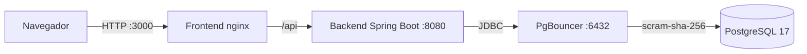

# Biblioteca Escolar

Sistema interno de gestão de biblioteca escolar, desenvolvido para a **Atividade 10: Gestão de Usuários e Aplicações** (aplicações fullstack com administração e segurança avançada no PostgreSQL). Tema **G2, Sistema de Gestão de Biblioteca Escolar**.

Operadores cadastrados fazem login e gerenciam livros, leitores, empréstimos e devoluções. O cálculo de atraso e multa acontece dentro do banco de dados.

## Funcionalidades

- Login de operadores pré-cadastrados (sem auto-cadastro ou recuperação de senha)
- CRUD de livros
- Cadastro de leitores, com o CPF criptografado no banco (pgcrypto)
- Empréstimos e devoluções, com multa calculada pelo banco (R$ 2,00 por dia de atraso)
- Lista de empréstimos atrasados e multa estimada
- Auditoria automática dos empréstimos (trigger)

## Arquitetura



| Serviço | Container | Tecnologia | Porta | IP na rede |
|---|---|---|---|---|
| frontend | biblioteca_frontend | nginx + JavaScript puro (SPA) | 3000 | 172.28.0.40 |
| backend | biblioteca_backend | Java 21, Spring Boot 4 | 8080 | 172.28.0.30 |
| pgbouncer | biblioteca_pgbouncer | PgBouncer (pool de conexões) | 6432 | 172.28.0.20 |
| db | biblioteca_db | PostgreSQL 17 | interna | 172.28.0.10 |

O banco só aceita conexões de rede vindas do PgBouncer (regra no `pg_hba.conf`). O enunciado cita três serviços (db, backend e frontend); o PgBouncer é o quarto, porque o pool de conexões é requisito obrigatório.

## Como executar

**Pré-requisitos:** Docker Desktop em execução e as portas 3000, 8080 e 6432 livres. Não é preciso instalar Java, Node nem PostgreSQL.

```bash
git clone https://github.com/Caio4breu/biblioteca-escolar-fullstack.git
cd biblioteca-escolar-fullstack
docker compose up -d --build
```

Aguarde cerca de 15 segundos (na primeira vez demora mais, porque as imagens são baixadas e o backend é compilado) e abra **http://localhost:3000**.

```bash
docker compose down          # desliga, mantendo os dados
docker compose down -v       # desliga e apaga os dados (o banco volta ao estado inicial)
```

## Acesso

### Login na aplicação (http://localhost:3000)

| Perfil | E-mail | Senha |
|---|---|---|
| Administrador | admin@biblioteca.local | admin123 |
| Atendente | atendente@biblioteca.local | atendente123 |

### Banco de dados

| Uso | Usuário | Senha |
|---|---|---|
| Escrita (usado pelo backend) | app_atendente | atendente123 |
| Somente leitura do catálogo | app_consulta | consulta123 |
| Administrador | postgres | postgres |

O Postgres não expõe a porta 5432. Para acessar o banco, use o container (o acesso local também exige senha, por causa do scram-sha-256):

```bash
docker exec -it biblioteca_db psql -U postgres -d biblioteca
```

O PgBouncer fica exposto em `localhost:6432` (banco `biblioteca`). São senhas de desenvolvimento, adequadas para este trabalho.

## Dados iniciais

Carregados automaticamente pelo `bd/backup.sql` na primeira criação do banco: 2 operadores, 3 livros, 2 leitores e 1 empréstimo já atrasado, para demonstrar a devolução com multa.

## Recursos de banco de dados

| Requisito do enunciado | Implementação |
|---|---|
| Schemas | `biblioteca`, `audit` e `extensions` |
| Usuários e permissões (RBAC) | roles `rl_atendente` e `rl_consulta`, usuários `app_atendente` e `app_consulta` |
| Pool de conexões | PgBouncer em modo transaction |
| Timeouts | `statement_timeout` (10 s) e `idle_in_transaction_session_timeout` (30 s) |
| Rede e autenticação | `pg_hba.conf` restrito ao IP do PgBouncer, com scram-sha-256 |
| Hardening | `REVOKE` do schema `public` e do banco para o grupo público |
| Prepared statements | parâmetros com `?` no JPA e no JdbcTemplate |
| Auditoria | trigger `trg_audit_emprestimo` grava em `audit.log_emprestimo` |
| Function | `fn_calcular_multa` |
| Procedure | `sp_realizar_devolucao` |
| Triggers | `trg_audit_emprestimo` e `trg_baixa_exemplar` |
| Views | `vw_emprestimos_atrasados` e `vw_livros_disponiveis` |
| Segurança de dados | pgcrypto: CPF criptografado e senhas com hash bcrypt |

## Verificando os recursos do banco

**Auditoria** (dentro do psql como `postgres`):

```sql
SELECT id, emprestimo_id, acao, status_antigo, status_novo, usuario_bd
FROM audit.log_emprestimo ORDER BY id DESC LIMIT 6;
```

**Timeout** (cancelado após 10 s; senha `atendente123`):

```bash
docker exec -it biblioteca_db psql -U app_atendente -d biblioteca -c "SELECT pg_sleep(15);"
```

**Permissões** (esperado: `permission denied`; senha `consulta123`):

```bash
docker exec -it biblioteca_db psql -U app_consulta -d biblioteca -c "SELECT * FROM biblioteca.leitor;"
```

**Bloqueio por IP** (esperado: o `pg_hba.conf` rejeita a conexão direta ao banco):

```bash
docker exec -it biblioteca_db psql -h 172.28.0.10 -U app_atendente -d biblioteca -c "SELECT 1;"
```

## API

Todas as rotas exigem autenticação HTTP Basic com o e-mail e a senha de um operador.

| Rota | O que faz |
|---|---|
| `GET /api/me` | Dados do operador logado |
| `GET, POST, PUT, DELETE /api/livros` | CRUD de livros |
| `GET, POST /api/leitores` | Lista e cadastra leitores |
| `GET, POST /api/emprestimos` | Lista e registra empréstimos |
| `GET /api/emprestimos/atrasados` | Atrasados com multa estimada |
| `POST /api/emprestimos/{id}/devolucao` | Registra a devolução e devolve a multa |

## Estrutura do repositório

```
docker-compose.yml
bd/
  postgresql.conf   timeouts e parâmetros do servidor
  pg_hba.conf       acesso restrito ao IP do PgBouncer, scram-sha-256
  backup.sql        DDL, function, procedure, triggers, views, roles e dados iniciais
pgbouncer/          pool de conexões
backend/            API Spring Boot
frontend/           SPA em JavaScript puro, servida pelo nginx
```

## Equipe

| Integrante | Área |
|---|---|
| Cassiano Abreu | Visão geral, Docker e README |
| Enzo Aquino | Banco de dados: modelagem e programação |
| Gabriel Naoki | Segurança e infraestrutura do PostgreSQL |
| Wyllian Mariano | Backend e integração com a SPA |
| Caio Abreu | Frontend e demonstração |
